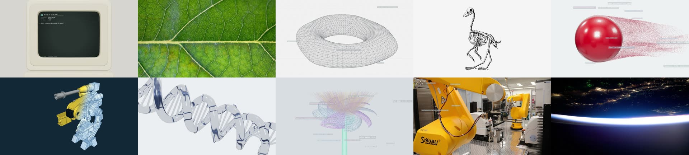

# flash-montage

An agent skill for the **flash montage**: the launch-teaser format where 150+ real-world objects (shells,
skeletons, turbines, aerials, galaxies, da Vinci pages, chrome 3D) cut past at 1–6 frames in three decelerating
bursts, each landing on a held hero object that glitches out into code, ending on a small wordmark.



Site: **https://arjunkshah12345-hash.github.io/flash-montage-site/** · Library:
**https://arjunkshah12345-hash.github.io/flash-montage-library/** ·
[](https://skills.sh/arjunkshah12345-hash/flash-montage)

```bash
npx skills add arjunkshah12345-hash/flash-montage
```

Then ask your agent for "a flash montage teaser for <product>".

## What's inside

- **A measured formula.** Every number comes from a frame-by-frame teardown of the Kimi K3.1 teaser (Oct 2026):
  159 shots in 24 s, median shot 2 frames, three bursts at `d(i) = a + (b − a)(i/(n−1))^p`, holds of 30/34/63
  frames, sound that marks bursts instead of cuts. See [`references/`](references/).
- **A builder.** `scripts/build_montage.py plan.json out/` writes a complete, editable
  [HyperFrames](https://hyperframes.heygen.com) project: origin scene, one scene per burst (every shot is a timed
  clip), live 3D holds, glitch layer, sound cues, an optional teaser end card, `SHOTLIST.json` and `CREDITS.md`.
- **28 procedural specimens.** Deterministic Three.js / canvas objects: particle sphere, x-ray flower, moon,
  chrome torus, glass DNA, galaxy, black hole, a retro terminal that types your prompt, and more.
- **An open image library.** 989 curated CC0 / public-domain / NASA / generated images on seamless grounds, each
  with licence, creator, source page, ground and palette. It lives in
  [flash-montage-library](https://github.com/arjunkshah12345-hash/flash-montage-library); download it with
  `python3 -I scripts/get_library.py`.
- **Research tools.** `analyze_cuts.py` (cut detection + shot sheets for any reference video) and `onsets.py`
  (audio onsets vs cuts).

## Quick start

```bash
SK=~/.agents/skills/flash-montage
python3 -I $SK/scripts/get_library.py                              # ~200 MB, once
python3 -I $SK/scripts/build_montage.py --example > plan.json      # edit brand / product / prompt / code
python3 -I $SK/scripts/build_montage.py plan.json ./my-montage
cd my-montage && npx hyperframes preview                           # look, tweak in Studio
npx hyperframes render -o renders/montage.mp4 -w 1
```

Requires Python 3.10+ with Pillow, Node 22+, ffmpeg.

## Licences

Code: MIT. Three.js (vendored): MIT. Library images: each under its own licence (CC0, public-domain mark, NASA
media guidelines, or generated by this project and dedicated CC0); every build writes the credits it used to
`CREDITS.md`. Sound cues reference the HyperFrames media-use bundled effects and are not redistributed here.
The teardown describes a third-party film for analysis; none of its frames or audio are included.
